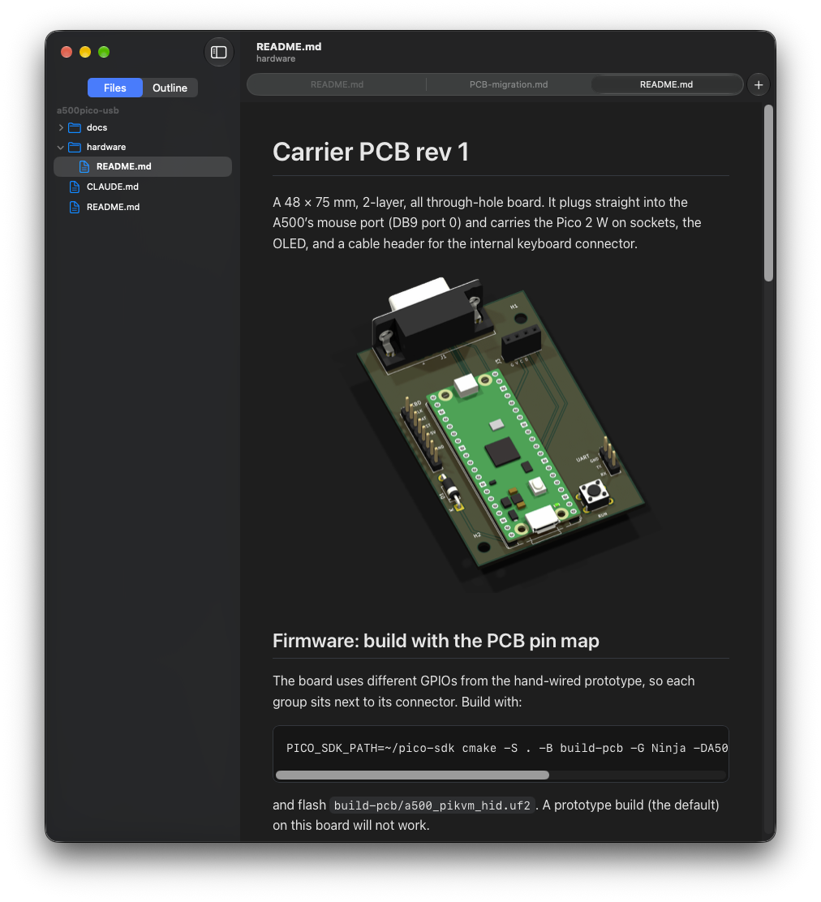

# Marky

A small, fast Markdown viewer for macOS, written in Swift, with a Quick Look extension.

| The app: tabs, Files sidebar, images, code, tables | Quick Look (Space in Finder) |
|---|---|
|  |  |

Markdown is rendered to HTML with [markdown-it](https://github.com/markdown-it/markdown-it) and
[highlight.js](https://highlightjs.org), both running inside JavaScriptCore. The app and the Quick Look
extension use the same renderer, so a file looks the same in both. Pages never run JavaScript of their
own, so a `<script>` in a Markdown file does nothing.

## Features

- GitHub-flavoured Markdown: tables, task lists, strikethrough, autolinks, footnotes, alerts
  (`> [!NOTE]` / TIP / IMPORTANT / WARNING / CAUTION), YAML front matter (folded away), raw HTML
- Syntax highlighting for 36 common languages, with light and dark palettes
- **Quick Look**: press Space on a `.md` file in Finder
- Reloads automatically when the file changes on disk, keeping your scroll position (works with editors
  that save by replacing the file)
- **Tabs and folders**: a sidebar with **Files** (the project's Markdown files: the git repository, or
  the file's folder) and **Outline** (the headings). Clicking a file or a link shows it in the same tab;
  ⌘-click a link, or right-click a file, to open it in a new tab. Native macOS tabs: ⌘T new tab, ⌘W close,
  ⌃⇥ / ⌃⇧⇥ next/previous tab, ⌘1–⌘8 jump to a tab, ⌘9 last tab, ⌘[ / ⌘] back/forward. ⌘O also opens a folder (it
  shows the folder's README). Open tabs are restored at the next launch.
- Sidebar ⌃⌘S, Files ⌃⌘1, Outline ⌃⌘2
- Find with every match highlighted and a match count (⌘F, ⌘G, ⇧⌘G, ⌘E, Esc)
- Zoom (⌘+ / ⌘= / ⌘- / ⌘0), remembered between launches
- Links: web links open in your browser, links to other `.md` files open in Marky, `#anchors` scroll the page
- Relative images next to the file are shown
- Print (⌘P), Export as PDF (⌥⌘P, paginated with the print style), Export as HTML (⇧⌘E), Reveal in Finder (⇧⌘R), Open in Text Editor (⌥⌘O),
  Copy File Path (⌥⌘C), Reload (⌘R)
- Settings (⌘,): appearance (Auto / Light / Dark), font (System / Serif / Rounded / Monospaced), font size,
  line width, syntax highlighting, smart quotes, auto-reload, open files as tabs, show the sidebar in new
  windows (off by default), default app for Markdown files (also asked once on first launch)
- **Every keyboard shortcut is editable** in Settings → Shortcuts (click, press the keys; ⌫ removes,
  right-click resets one, Restore Defaults resets all). Clashes are flagged.

## Build and release

Requires Xcode 16+ and [XcodeGen](https://github.com/yonaskolb/XcodeGen) (`brew install xcodegen`).

```bash
scripts/release.sh --install
```

Builds Release, signs the app and the Quick Look extension with the team's Developer ID
(`Developer ID Application: Stefan Skotte (3WT5WSV6B5)`, hardened runtime, secure timestamp), notarizes and
staples the app, makes `build/release/Marky-<version>.dmg` (signed, notarized, stapled), checks everything
with `codesign` / `spctl`, and with `--install` copies the app to `/Applications`. `--skip-notarize` signs
only. Notarization uses the keychain profile `minibro-notary` (the team's App Store Connect API key, shared
with Minibro); override with `NOTARY_PROFILE=<profile>`. The version is `MARKETING_VERSION` in `project.yml`.

Bundle ids: `dk.enhance-it.marky` and `dk.enhance-it.marky.quicklook` (until 2026-11-26 `app.marky.Marky`;
settings from that are copied over on first launch).

Every build copy registers its own Quick Look extension with macOS. `release.sh` removes its working copies
and runs `scripts/clean-registrations.sh`, which unregisters every Marky except `/Applications/Marky.app`.
Run it yourself after Debug builds from Xcode.

For a quick Debug build: `xcodegen generate && xcodebuild -project Marky.xcodeproj -scheme Marky -derivedDataPath build build`
(ad-hoc signed).

To make Marky the default app for Markdown: Finder → Get Info on a `.md` file → Open with → Marky →
Change All…

`Samples/Welcome.md` covers every feature and is handy for checking a build.

## Layout

| Path | What |
|------|------|
| `Shared/` | Renderer (`MarkdownRenderer.swift`), JS libraries, `render.js`, `markdown.css`. Built into both targets |
| `Marky/` | The app: AppKit tab windows (`WindowManager`) hosting SwiftUI views, WKWebView, folder scanner, find/zoom bridge (`Resources/bridge.js`), settings |
| `QuickLook/` | Data-based Quick Look preview extension (sandboxed) |
| `scripts/make-icon.swift` | Recreates the app icon |
| `project.yml` | XcodeGen spec (the `.xcodeproj` is generated) |

## Known limitations

- Quick Look uses the default style and follows the system appearance. It does not read the app's settings
  yet (that needs an App Group; see the backlog).
- Quick Look has read-only access to the disk (a sandbox exception, allowed outside the App Store) so it
  can show relative images. Remote images may not load there.
- The app isn't sandboxed, so it can read images and linked files next to the document.

## Backlog

- [x] **Signing:** Developer ID + hardened runtime + notarization via `scripts/release.sh`, done 2026-11-26.
- [ ] **Quick Look follows the app's settings** (appearance, font, width): needs an App Group shared by the
  app and the extension.
- [x] **Duplicate Quick Look registrations** (3 were listed): `scripts/clean-registrations.sh`, also run by
  `release.sh`. Done 2026-11-26.
- [ ] **Smeared name in the Files sidebar:** the selected row's text (e.g. `README.md`) can look squeezed
  or doubled after a file is opened as a new tab from Finder or `open`. Navigating within a tab draws it
  correctly. Cause not found yet; not the line limit or font weight.
- [ ] **Keyboard in the Files sidebar:** → / ← don't expand or collapse folders.
- [ ] **Same-name tabs:** two `README.md` tabs look identical; show the folder when names clash.
- [ ] **Themes and formats:** see which popular themes we can support (GitHub, GitLab, Obsidian, Typora,
  Bear and similar "hub" styles, maybe user CSS), and extra formats/extensions (Mermaid diagrams,
  KaTeX math, wiki-links, emoji shortcodes).
- [x] **Folder navigation and tabs:** Files sidebar + native tabs (⌘T / ⌘W), done 2026-11-26.
- [x] **Quick Look relative images**: fixed 2026-11-26 with a read-only sandbox exception.
